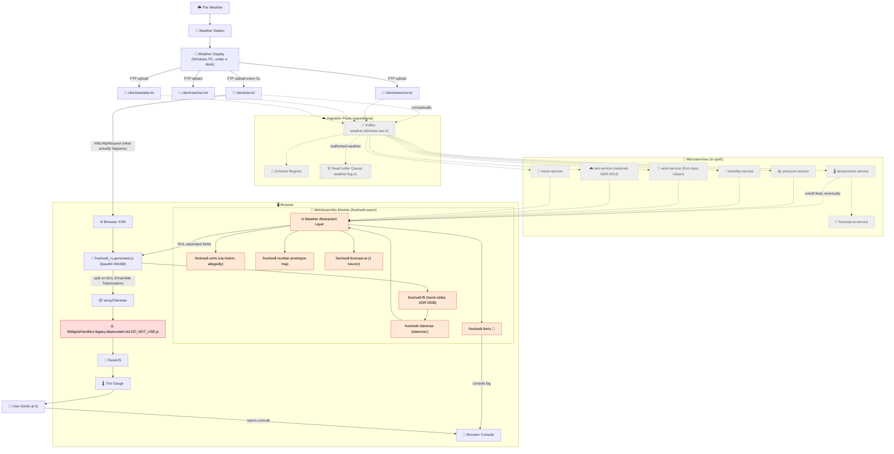
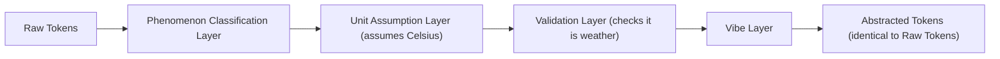
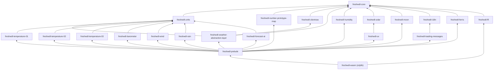
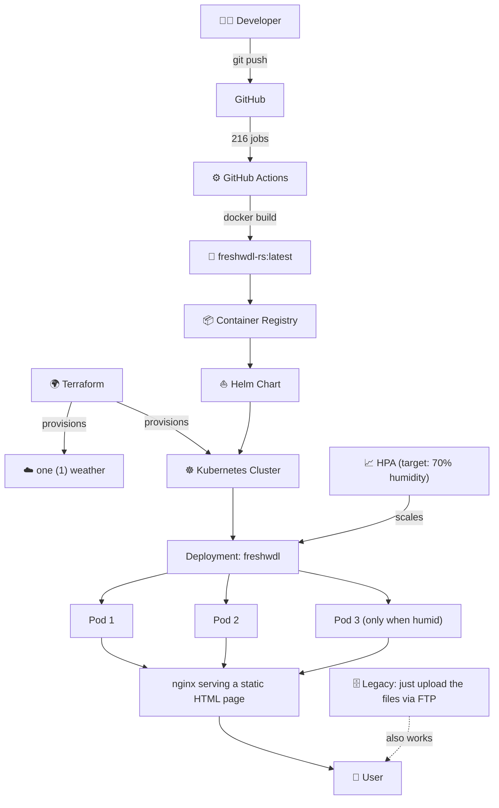
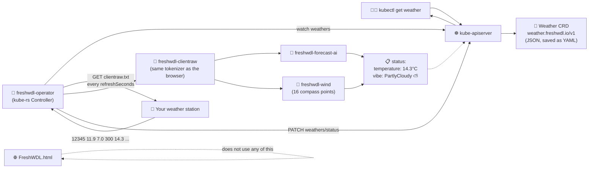
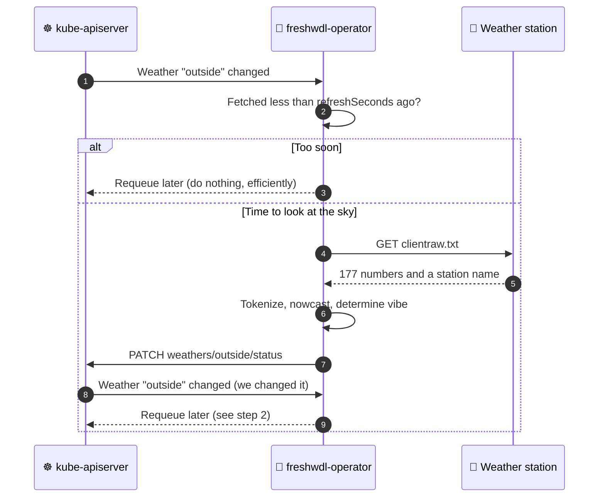
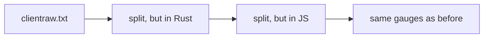

# 🏗️ FreshWDL-rs Architecture

> Certainly! Below is a comprehensive overview of the FreshWDL-rs architecture. I've structured it to be accessible to newcomers while still providing the depth that experienced engineers expect.

---

## 📖 Contents

1. [Executive Summary](#1-executive-summary)
2. [Guiding Principles](#2-guiding-principles)
3. [High-Level Architecture](#3-high-level-architecture)
4. [Request Lifecycle (Sequence Diagram)](#4-request-lifecycle)
5. [The Weather Abstraction Layer (WAL)](#5-the-weather-abstraction-layer-wal)
6. [Crate Dependency Graph](#6-crate-dependency-graph)
7. [The FFI Boundary](#7-the-ffi-boundary)
8. [Deployment Topology](#8-deployment-topology)
9. [What Actually Happens](#9-what-actually-happens)
10. [Glossary](#10-glossary)

---

## 1. Executive Summary

FreshWDL-rs is a **cloud-native, event-driven, hexagonal, microkernel-based weather visualization platform** that reads a text file and draws a thermometer. 🌡️

It is composed of:

- **23** Rust crates
- **1** WebAssembly module
- **1** base64-encoded JavaScript file containing that WebAssembly module
- **1** legacy JavaScript file that does all the rendering (`WidgetsHandlers.legacy.deprecated.old.DO_NOT_USE.js`)
- **1** Kafka cluster (conceptual)
- **1** Kubernetes Deployment (optional, encouraged)
- **1** Terraform-managed weather

The architecture has been designed to scale **horizontally** (more pods), **vertically** (bigger pods) and **meteorologically** (more weather).

---

## 2. Guiding Principles

| # | Principle | What it means in practice |
|---|---|---|
| 1 | **Memory Safety First** 🛡️ | Weather must never be accessed after it has been freed. |
| 2 | **Zero-Cost Abstractions** ⚡ | Every abstraction costs nothing at runtime and everything at review time. |
| 3 | **Separation of Concerns** 🧩 | Each crate has exactly one concern. Some crates share a concern. |
| 4 | **Fearless Concurrency** 🦀 | Single-threaded, but bravely. |
| 5 | **Backwards Compatibility** ♻️ | The page must look identical to before, pixel for pixel. |
| 6 | **Observability** 🔭 | If the temperature changes, a crab must know about it. |
| 7 | **Enterprise-Readiness** 🏢 | Loading screens must last at least 5 seconds. |

---

## 3. High-Level Architecture

The diagram below shows the full flow of data through FreshWDL-rs, from the weather station to the gauge.



**Legend:**

- **Solid lines** — things that actually happen.
- **Dashed lines** — things that would happen in a sufficiently enterprise future.
- 🟥 **Red** — the file that does all of the work, which you should not use.
- 🟧 **Orange** — Rust. 🦀

---

## 4. Request Lifecycle

The sequence diagram below shows what happens every 5 seconds, when `updateClientraw()` fires.

```mermaid
sequenceDiagram
    autonumber
    participant Timer as ⏱️ setInterval (5000 ms)
    participant Legacy as ⚠️ DO_NOT_USE.js
    participant Server as 🌐 Web Server
    participant Shim as 🔌 freshwdl_rs.generated.js
    participant FFI as 🦀 freshwdl-ffi
    participant Tok as 🦀 freshwdl-clientraw
    participant WAL as ⚖️ WAL
    participant Ferris as 🦀 freshwdl-ferris
    participant Console as 🖥️ Console
    participant Gauge as 🌡️ Gauge

    Timer->>Legacy: updateClientraw()
    Legacy->>Server: GET clientraw.txt?nocache=...
    Server-->>Legacy: "12345 11.9 7.0 300 14.3 ..."
    Legacy->>Shim: parseClientraw(text)
    Shim->>Shim: TextEncoder.encode(text)
    Shim->>FFI: freshwdl_alloc(len)
    FFI-->>Shim: ptr
    Shim->>Shim: copy bytes into linear memory
    Shim->>FFI: tokenize(ptr, len)
    FFI->>Tok: tokenize(&str)
    Tok->>Tok: split on whitespace (in Rust 🚀)
    Tok->>Tok: Meteohub compat: "-" → "0"
    Tok->>WAL: abstract(tokens)
    WAL->>WAL: validate the weather
    WAL->>Ferris: log(fields = 177)
    Ferris->>Console: 🦀 [INFO] tokenized in Rust. This is fine.
    WAL-->>Tok: tokens
    Tok-->>FFI: join with NUL
    FFI-->>Shim: ptr and len, packed into one u64
    Shim->>Shim: BigInt unpack
    Shim->>Shim: TextDecoder.decode
    Shim->>FFI: freshwdl_dealloc() (input only; the output buffer is kept forever, for performance)
    Shim->>Shim: .split("\0")  (Final-Mile Tokenization™)
    Shim-->>Legacy: ["12345", "11.9", "7.0", ...]
    Legacy->>Legacy: arrayClientraw = result
    Legacy->>Gauge: dispatchEvent("clientRawDataUpdate")
    Gauge->>Gauge: redraw (exactly as before)
    Note over Legacy,Gauge: The gauge has no idea any of this happened.
```

---

## 5. The Weather Abstraction Layer (WAL)

The **Weather Abstraction Layer** (`freshwdl-weather-abstraction-layer`) is the heart of FreshWDL-rs. ❤️

It sits between the tokenizer and the rest of the system, and abstracts the weather.

### 5.1 Responsibilities

- Receiving tokens from `freshwdl-clientraw`
- Abstracting them
- Passing them on

### 5.2 Why do we need a WAL?

Without a WAL, the tokenizer would hand tokens directly to the FFI layer. This would create a **tight coupling** between the parsing of the weather and the returning of the weather. If we ever wanted to change how the weather is returned, we would have to change the tokenizer.

With a WAL, the tokenizer hands tokens to the WAL, which hands them to the FFI layer. If we ever want to change how the weather is returned, we can change the WAL instead. 🎉

### 5.3 Layers of the WAL



---

## 6. Crate Dependency Graph



> 💡 **Note:** `freshwdl-uv` depends on `freshwdl-solar` because UV comes from the sun. This is the only dependency in the workspace that is grounded in physics.

---

## 7. The FFI Boundary

Because we rejected `wasm-bindgen` ([ADR-0008](docs/adr/0008-reject-wasm-bindgen.md)), the FFI boundary is hand-rolled.

### 7.1 Calling Convention

| Step | Side | Action |
|---|---|---|
| 1 | JS | `TextEncoder.encode(input)` |
| 2 | JS → Rust | `freshwdl_alloc(len)` |
| 3 | JS | Copy bytes into `memory.buffer` |
| 4 | JS → Rust | Call exported function with `(ptr, len)` |
| 5 | Rust | Do the actual work (the important 0.6%) |
| 6 | Rust → JS | Return a `u64` containing `(out_ptr << 32) \| out_len` |
| 7 | JS | Unpack with `BigInt` |
| 8 | JS | `TextDecoder.decode(...)` |
| 9 | JS → Rust | `freshwdl_dealloc` (input) |
| 10 | JS → Rust | `freshwdl_dealloc` (output) |
| 11 | JS | `.split("\0")` |

Eleven steps to replace one `.split(" ")`. That's the power of Rust. 🦀

### 7.2 Safety

Every `unsafe` block at the FFI boundary has a `// SAFETY:` comment. A representative sample:

```rust
// SAFETY: it's only drizzle
```

---

## 8. Deployment Topology



---

## 8½. Kubernetes-Native Weather ☸️

As of [ADR-0016](docs/adr/0016-kubernetes-native-weather.md), the weather is a Kubernetes Custom Resource, reconciled by `freshwdl-operator`. Unlike most of this document, this part is real.



### Reconcile Loop



---

## 9. What Actually Happens

For completeness, and in the interests of transparency, here is a simplified view of what actually happens at runtime:



---

## 10. Glossary

| Term | Definition |
|---|---|
| **clientraw.txt** | A file containing the weather, separated by spaces. |
| **Final-Mile Tokenization™** | Splitting the string in JavaScript after Rust has finished splitting it ([ADR-0005](docs/adr/0005-final-mile-tokenization.md)). |
| **WAL** | Weather Abstraction Layer. Not to be confused with a write-ahead log, which would be useful. |
| **Ferris** | The Rust mascot. Lives in the console now. 🦀 |
| **Meteohub compatibility** | Replacing `-` with `0`. Now memory safe. |
| **DO_NOT_USE.js** | The file that is used. |
| **Phantom type** | A type that exists at compile time but not at runtime, like most of our architecture. |
| **One (1) weather** | The unit of weather provisioned by Terraform. |
| **Enterprise Loading Effect** | The increase in user trust from waiting 5 seconds ([ADR-0010](docs/adr/0010-artificial-minimum-loading-time.md)). |

---

I hope this overview helps! Let me know if you'd like me to add more diagrams, expand any section, or generate an architecture diagram for the architecture diagrams. 😊
